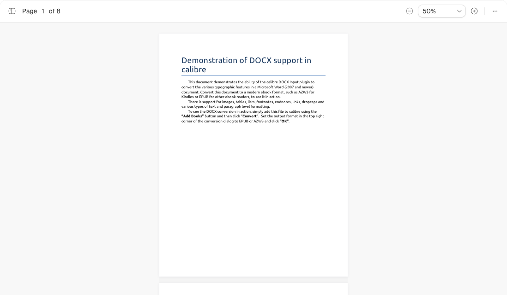
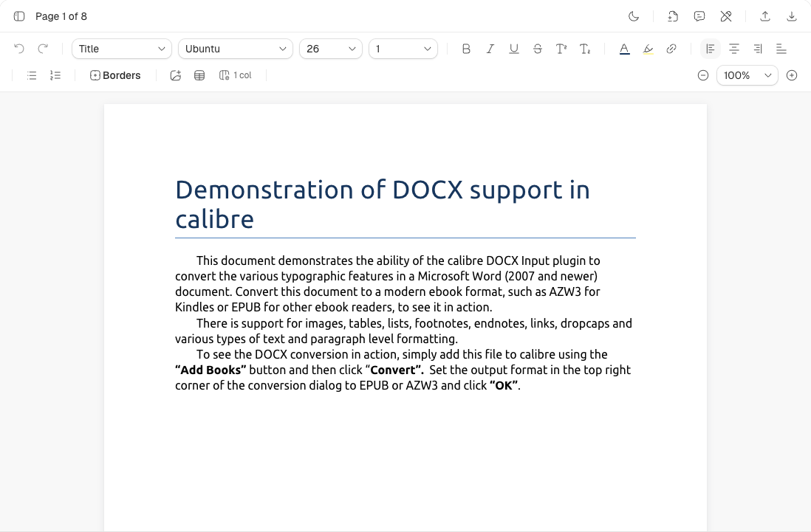

# react-docx

[](https://www.npmjs.com/package/@extend-ai/react-docx)
[](https://www.npmjs.com/package/@extend-ai/react-docx)

JavaScript and React DOCX viewer/editor with pagination, editing, import/export, document review and thumbnails. It also opens legacy Word files and offers **experimental, view-only support for OpenDocument text** (`.odt`); see [supported formats](packages/react-viewer/README.md#supported-formats). The browser runtime uses the Rust/WASM parser from [Rust Office](https://github.com/extend-hq/rust-office).

## Quick start

```bash
pnpm add @extend-ai/react-docx
```

React integrations require `react` and `react-dom`; the `/vanilla` entry bundles Preact.

```tsx
import { DocxEditorViewer, useDocxEditor } from "@extend-ai/react-docx";

export function DocumentViewer() {
  const editor = useDocxEditor();
  return (
    <>
      <input type="file" accept=".docx" onChange={(event) => {
        const file = event.target.files?.[0];
        if (file) void editor.importDocxFile(file);
      }} />
      <DocxEditorViewer editor={editor} mode="read-only" defaultZoom="fit-width" />
    </>
  );
}
```

Use `mode="edit"` for editing and `editor.exportDocx()` for export. For a parsed document, use `useDocxEditor({ document })`. Vanilla apps use `createDocxViewer` from `@extend-ai/react-docx/vanilla` and call `destroy()` on teardown.

[Full API and hooks](packages/react-viewer/README.md) · [Vanilla API](packages/react-viewer/README.md#vanilla-javascript) · [Thumbnails](packages/react-viewer/README.md#thumbnail-only-rendering)

## Integration notes

- WASM loads lazily. Configure `setWasmSource` before the first parse/export for custom hosting; see [WASM and Vite setup](packages/react-viewer/README.md#webassembly-asset).
- Built-in imports require a Web Worker. `parseDocxForViewer` permits main-thread fallback unless `useWorker: "required"` is set. Layout and React rendering run on the main thread.
- Embedded fonts load by default. After changing caller fonts, call `refreshDocxFontMetrics()`; recreate standalone thumbnail renderers. See [font handling](packages/react-viewer/README.md#caller-fonts).
- Review mutations support limited text revisions and plain-text comment ranges. Unsupported or stale actions leave the document unchanged; [review hooks and boundaries](packages/react-viewer/README.md#useful-hooks) describe the contract.
- OpenDocument text support (`.odt`, `.ott`, `.odm`, `.otm`, `.oth`, flat `.fodt`) is **experimental and view-only**; rendering coverage and layout fidelity may vary. `editor.viewOnlyReason` is set, the viewer renders read-only in any `mode`, and `exportDocx()`/`getDocxBytes()` are refused. [What is and is not displayed](packages/react-viewer/README.md#supported-formats).
- Saved 3D previews remain visible; `parseDocxForViewer(source, { include3dModels: true })` additionally exposes original assets and scene XML. [Shared renderer coverage](https://github.com/extend-hq/rust-office/blob/main/docs/picture-coverage.md) distinguishes rendering from preserved previews.

## Development

Use Node.js from [`.nvmrc`](.nvmrc) and pnpm 9.15.0; supported Node ranges are in [package.json](package.json).

```bash
pnpm install --frozen-lockfile
pnpm dev
pnpm build
pnpm typecheck
pnpm test:unit
pnpm test:visual
```

| Work | Start here |
| --- | --- |
| Public viewer, controller and hooks | [packages/react-viewer](packages/react-viewer) |
| OOXML parts and normalized model | [packages/ooxml-core](packages/ooxml-core), [packages/doc-model](packages/doc-model) |
| Editing and DOCX export | [packages/editor-ops](packages/editor-ops), [packages/serializer](packages/serializer) |
| Pagination and layout | [packages/layout-engine](packages/layout-engine), [packages/layout-core](packages/layout-core) |
| WASM build and Rust adapter | [packages/wasm](packages/wasm), [crates/docx-wasm](crates/docx-wasm) |
| Manual and automated validation | [apps/playground](apps/playground), [tests](tests), [Word fidelity harness](docs/word-fidelity-harness.md) |

Parser fixes belong in [Rust Office](https://github.com/extend-hq/rust-office). Normal JS builds validate the committed WASM; [runtime updates](docs/rust-publishing.md) must include rebuilt bindings, lockfiles, provenance and notices. npm releases use Changesets; Rust and npm versions are independent. See [playground deployment](docs/playground-deployment.md) for build provenance.

## Visual comparisons

### Microsoft Word charts

[](https://github.com/extend-hq/rust-office/blob/7d8d3e2d13ae2076c5e4e23333f2f5725b67c85f/docs/chart-comparisons.md)

November 4, 2026, React DOCX 0.14.0: **155/157 charts rendered**, with 28 pairs in this overview. [Galleries, measurements and method](https://github.com/extend-hq/rust-office/blob/7d8d3e2d13ae2076c5e4e23333f2f5725b67c85f/docs/chart-comparisons.md) retain differences and missing charts. [Parser benchmarks](https://github.com/extend-hq/rust-office/blob/main/docs/docx-benchmarks.md) measure native extraction separately from viewer layout.

### Office Art

[](https://github.com/extend-hq/rust-office/blob/7d8d3e2d13ae2076c5e4e23333f2f5725b67c85f/docs/office-art-comparisons.md)

November 6, 2026: **30 native-adapter cases** covering SmartArt, WordArt, 3D previews, shapes, icons and ink. These captures measure the shared renderer, not this npm release's pagination. Font substitution, curved text, shading and pencil texture remain limited.

[WordArt and 3D shapes](https://raw.githubusercontent.com/extend-hq/rust-office/7d8d3e2d13ae2076c5e4e23333f2f5725b67c85f/docs/readme-assets/word-officeart-expanded-wordart-and-3d.png) · [Models and SmartArt](https://raw.githubusercontent.com/extend-hq/rust-office/7d8d3e2d13ae2076c5e4e23333f2f5725b67c85f/docs/readme-assets/word-officeart-expanded-models-and-smartart.png) · [Icons and ink](https://raw.githubusercontent.com/extend-hq/rust-office/7d8d3e2d13ae2076c5e4e23333f2f5725b67c85f/docs/readme-assets/word-officeart-expanded-icons-shapes-and-ink.png) · [Method and remaining gaps](https://github.com/extend-hq/rust-office/blob/7d8d3e2d13ae2076c5e4e23333f2f5725b67c85f/docs/office-art-comparisons.md)

### Live demos

[](https://www.extend.ai/ui/docs/components/docx-viewer)

[](https://www.extend.ai/ui/docs/components/docx-editor)

Click the screenshots for viewer/editor demos and integration docs. [MIT license](LICENSE).
