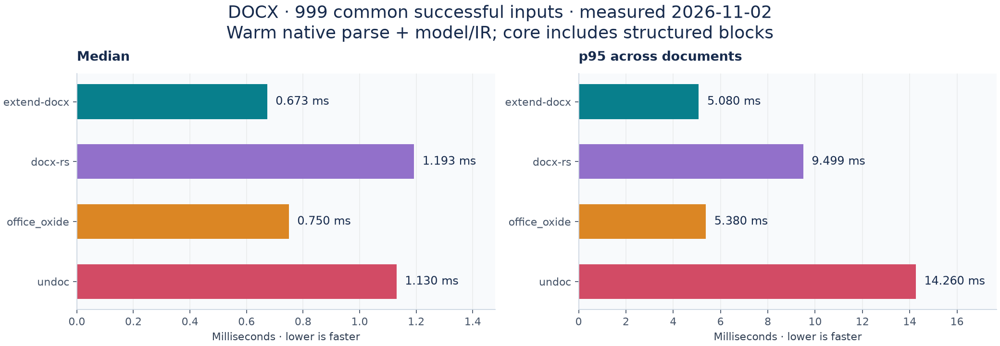
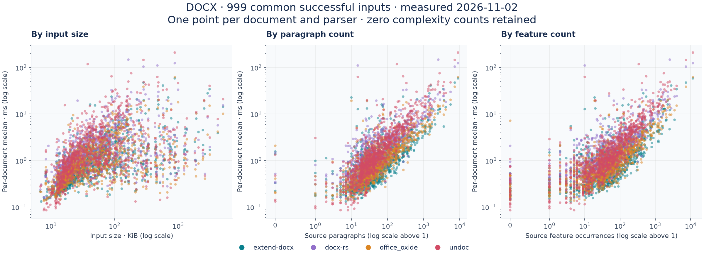
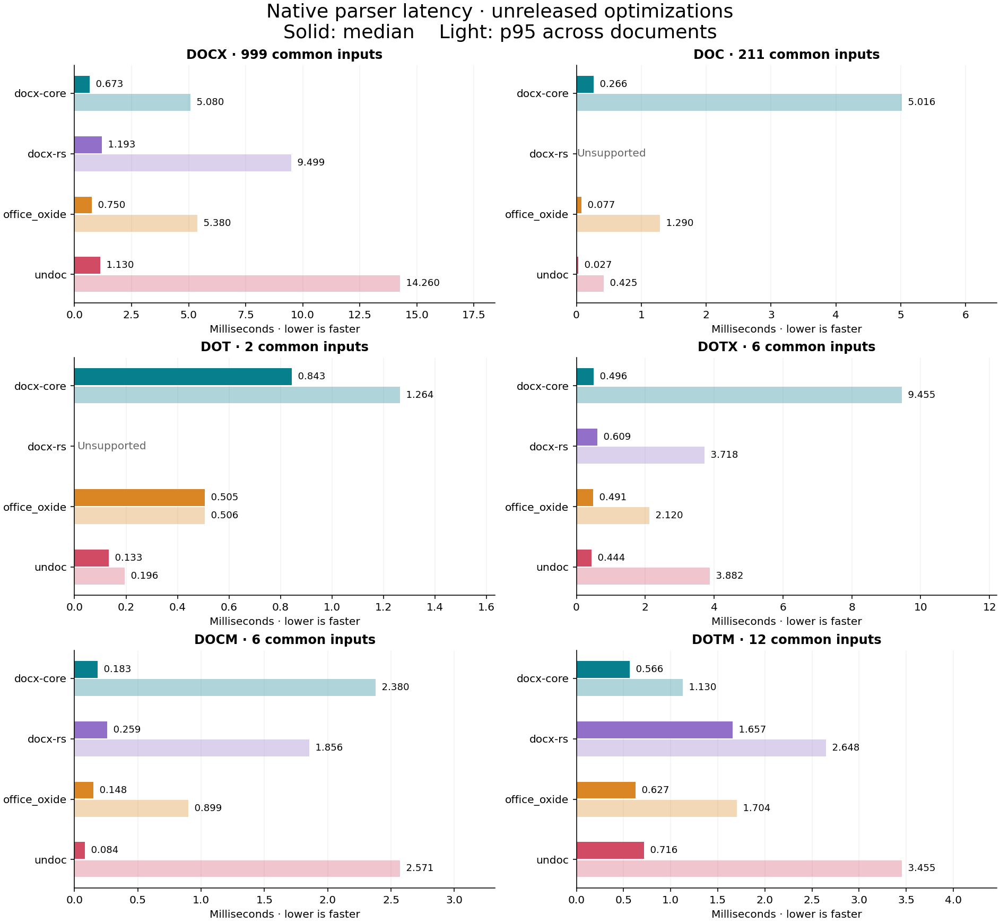
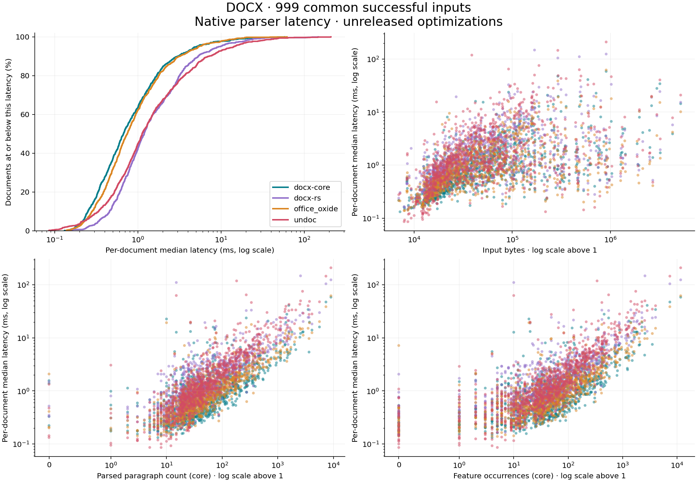
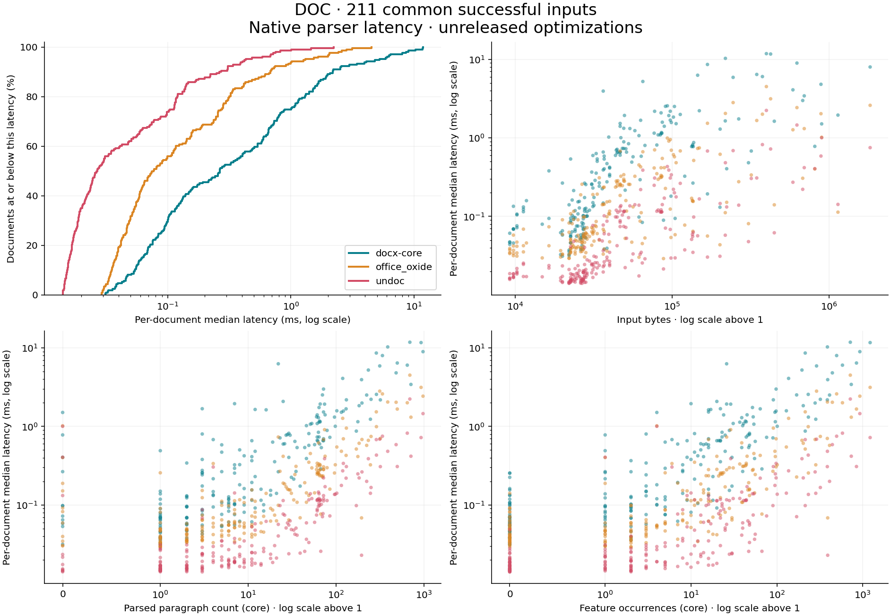
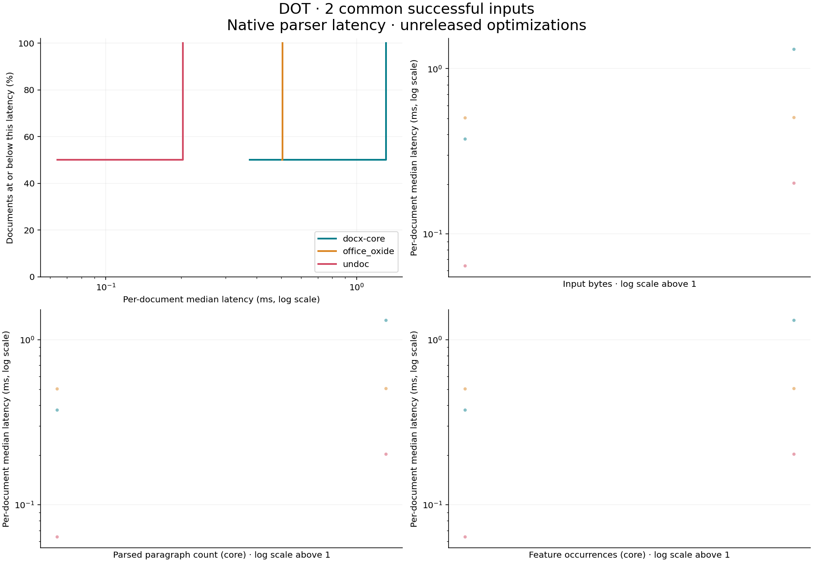
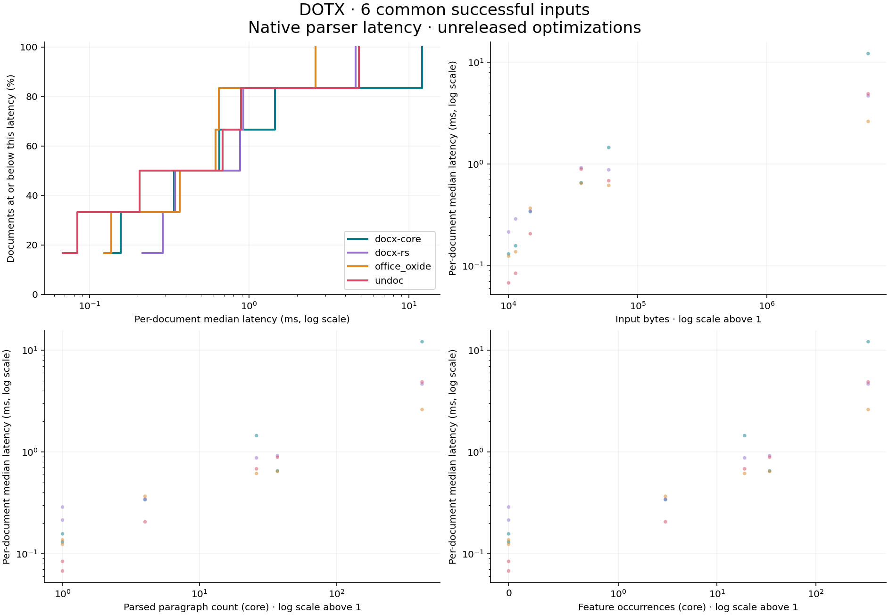
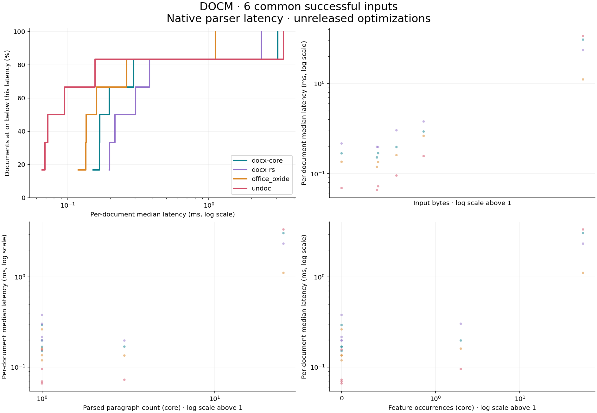
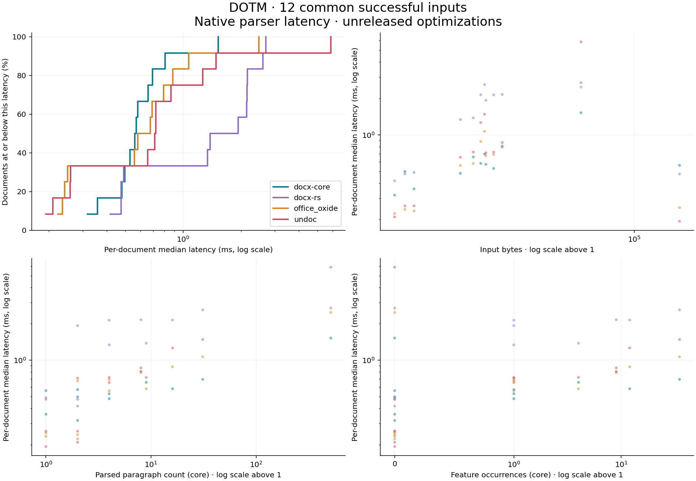
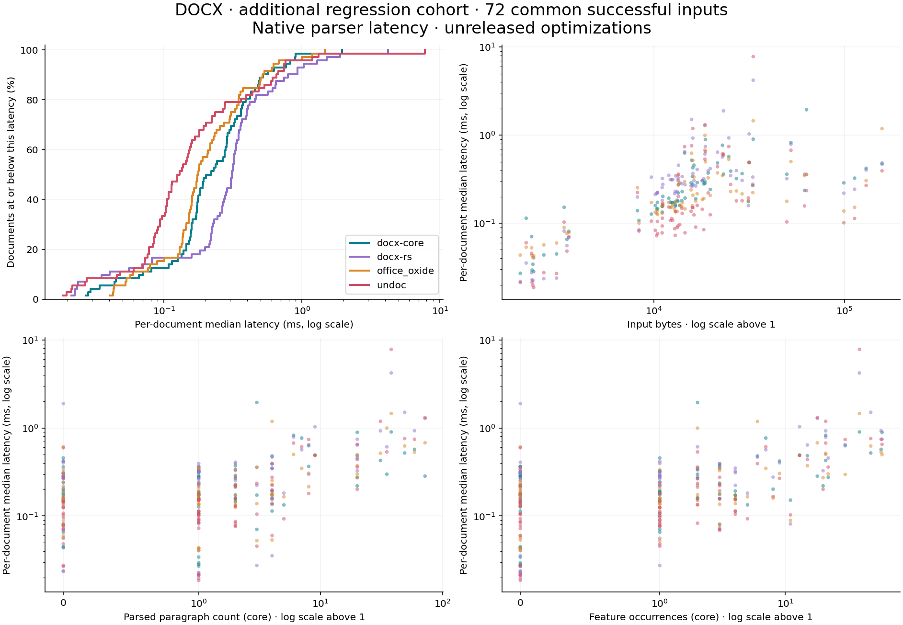

# extend-docx

[](https://crates.io/crates/extend-docx)

Extend's native Rust parser, document model, and serializer, shared with the React viewer through WebAssembly. It accepts OOXML DOCX and Word 97–2003 binary DOC through the existing format adapter. No browser, Word installation, or network service is required for parsing.

## Installation

```sh
cargo add extend-docx
```

The Cargo package is `extend-docx`; the Rust import is `extend_docx`. The source lives in `crates/extend-docx` within [extend-hq/react-docx](https://github.com/extend-hq/react-docx/tree/main/crates/extend-docx). Rust crate versions are independent of the `@extend-ai/react-docx` npm versions. The internal `docx-wasm` package provides the JavaScript bindings and is not published to crates.io.

Native builds enable `native-deflate` by default, using libdeflate for whole-buffer ZIP decompression and reusing its decoder across package entries. This requires a C compiler at build time. Disable default features to use the portable Rust decoder. WebAssembly always uses the Rust decoder. Both paths retain the same fallback for entries whose declared size cannot be used for bounded preallocation.

```toml
[dependencies]
extend-docx = { version = "0.1", default-features = false }
```

## Usage

```rust
let package = extend_docx::parse_document_bytes(&bytes)?;
let model = extend_docx::build_doc_model(&package);
let blocks = extend_docx::extract_document_blocks(&model);
let json = serde_json::to_string(&blocks)?;
```

`parse_document_blocks(&bytes)` combines these steps. `cargo run --example parse_blocks -- input.docx` writes the block JSON to standard output.

Word spans are optional:

```rust
let options = extend_docx::ExtractDocumentBlocksOptions { include_words: true };
let blocks = extend_docx::parse_document_blocks_with_options(&bytes, options)?;
```

Use `extract_document_blocks_with_options(&model, options)` for an existing model, or add `--include-words` to the CLI. The TypeScript equivalent is `extractDocumentBlocks(model, { includeWords: true })`. Existing calls omit word data.

### Native chart data

A native chart figure carries `details.chartPartName` in structured blocks and `ImageRunNode::chart_part_name` in the model. Pass that part name and the parsed package to `extract_chart_data(&package, part_name)` to read a `ChartData` without rendering the chart. Series retain their chart type and points are sorted by the original zero-based index. Categories retain their hierarchy level. Values, XY coordinates and bubble sizes are optional strings to preserve precision and distinguish blanks from zero. Data comes from literal values and cached formula results stored in the chart. An uncached reference contributes no points.


Paragraph-derived blocks, including those in tables and auxiliary stories, then include `words`. Each word has an ID, its parent `blockId`, original `content`, and document-bound source references with UTF-16 `start`/`end` offsets into the paragraph block's content. Segmentation uses Unicode word boundaries and includes punctuation and symbols; whitespace-only segments are omitted. It is not dictionary-based linguistic segmentation. Styled run boundaries do not split a word, and capitalization formatting does not rewrite its source text. Word rectangles are resolved by the viewer after layout, just like block rectangles.

The versioned output uses Extend's 15 block type names. Each block retains document-bound source references; paragraphs retain styled inline content, tables retain cells and spans, and text boxes retain nested content. Header/footer stories, notes, comments, form controls, and equations are represented where supported by the parser. Image blocks expose their render payload through `details.imageUrl`, including SVG composites, charts, text boxes, and converted images. Existing `details.asset` values continue to identify source package parts. A data URI carries its payload with the block; external URLs remain references and are never fetched during extraction. If an imported model has image bytes but no nonblank URL, extraction encodes those bytes as a data URI. Empty payloads do not create an `imageUrl` field. Original image bytes remain available in the parsed package.

`document_source_graph(&package)` provides an optional namespace-aware tree of XML elements, attributes, text, and an asset manifest. Original XML and binary assets remain in `package`. XML byte ranges refer to the decoded UTF-8 strings. For legacy DOC, the graph describes the adapter's OOXML output; keep the original DOC bytes to preserve unsupported binary structures.

Page numbers and bounding boxes require layout. The native parser deliberately returns `geometryStatus: "requires_layout"`. Use the matching React viewer to resolve source references against rendered pages. Source identity is a SHA-256 digest of the sorted, decoded package parts and assets, independent of ZIP compression and entry order. It is not the digest of the original ZIP bytes. Keep the original upload digest separately. Imported source IDs are stable for the same package and parser version; reimport edited bytes as a new document version.

The source graph preserves structure beyond the semantic block model. This is not a promise of complete semantic extraction or Word-identical rendering. Imported HTML, subdocuments, embedded programs/objects, diagrams, and equation layout have explicit diagnostics where recognized. Unknown extension markup can be inspected in the source graph. Dynamic fields use imported values; they are not a general field calculation engine. Encrypted files and older binary formats are not covered by the Word 97–2003 adapter.

## Logical and physical table columns

Table-cell `gridSpan` and structured table `columnIndex`, `columnSpan`, and `columnCount` describe the logical OOXML grid. A fixed-layout table can retain distinct logical columns whose resolved physical boundaries coincide. Its model style then includes `collapsedGridColumns`, listing the zero-width logical intervals in `columnWidthsTwips`. These intervals are not independently drawable columns. Structured table details describe logical extraction and are not a replacement for the model's layout grid.

The matching React viewer projects marked tables to their positive-width physical columns before layout, border resolution, DOM spans, and resize measurement. Structural edits materialize that physical grid and invalidate the edited table's source cache and any containing table caches. Untouched export and supported text edits retain the original source grid. Source-less export projects to the physical grid without changing the logical input model.

Rust callers can use `table_grid::materialize_collapsed_table_grid` before structural edits. `table_grid::validate_collapsed_table_grids` checks the entire model, including nested tables, image content, and auxiliary stories. `serialize_docx` and the WASM serialization entry points call this validation and reject unsupported markers. The legacy infallible `model_to_document_xml` and `serialize_doc_model` APIs retain their return types; callers supplying external models must validate first. Unsupported style or border changes must materialize the marked grid before applying the change.

For fixed-layout tables with automatic table width, supported conflicting cell-width preferences resolve against shared logical columns. The bounded solver requires complete positive singleton anchors and explicit positive cell preferences, excludes vertical-merge continuation preferences, and preserves source spans. Tables outside those conditions retain the existing fallback; this does not claim universal Word layout equivalence.

## Shared formatting in the Rust model

Run, form-field, paragraph-mark, and imported provenance formatting use `SharedTextStyle`, which owns a fully resolved `TextStyle` through `Arc`. Cloning these values shares the formatting allocation. Mutable access copies it only when another model value still shares it, so editing a run cannot change another run or its imported provenance. The model remains transferable across threads.

This changes these Rust fields from `Option<TextStyle>` to `Option<SharedTextStyle>`. Convert an owned style with `.into()` when constructing a field, use `.as_deref()` to borrow a `TextStyle` from an optional field, or call `.into_owned()` to obtain an owned style. Standalone `parse_run_style` continues to return `Option<TextStyle>`.

Serde serializes the complete underlying formatting object transparently. JSON and TypeScript field shapes are unchanged, and style resolution finishes during parsing.

`ParagraphChildNode::Image` and `ParagraphChildNode::FormField` hold boxed payloads, keeping ordinary text slots small. Rust callers constructing these variants should wrap their payload with `Box::new`; borrowed field access continues through dereferencing. Serialization includes the complete payload with no additional wrapper.

See the repository's structured-block design document for the viewer contract, integration steps, validation evidence, and remaining coverage gaps.

## Tracked revisions

Call `parse_document_blocks_with_revisions(bytes, options)` or `extract_document_blocks_with_revisions(&model, options)` to get a `ReviewedDocument`. Its `document` contains the current blocks and its `revisions` contains the edits recorded in the source. The JSON representation adds a `revisions` array alongside `blocks`. The existing block extraction functions keep their original output.

Each revision has an opaque ID unique to the input document, its kind and scope, and source references to affected blocks. The original Word revision ID, author, timestamp, and move name are optional. Source ranges use half-open UTF-16 offsets in the current paragraph text. A deletion retains the removed text and a point at its former position. Review extraction keeps otherwise empty blocks that anchor edits. A block-level reference has no offsets when the change is structural or its source text cannot be aligned with the current model.

OOXML supports insertions, deletions, move sources and destinations, paragraph marks, and changes to run, paragraph, section, table, row and cell properties. Property changes carry the previous and current direct Word properties. The two sides of a move can share an explicit move name. Legacy binary Word input preserves text insertions and deletions where the character properties record them. Binary timestamps carry minute precision and no time zone. This API reads revisions retained in the input document.

## Third-party notices

The symbol-font Unicode mapping is derived from `dingbat-to-unicode` 1.0.1 by Michael Williamson, distributed under the BSD 2-Clause license. The complete notice is in `third-party/dingbat-to-unicode-LICENSE` and is included in the WASM and viewer distributions.

## Typed structured details in Rust

`DocumentBlock.details` uses `structured::BlockDetails`. Generated paragraph details are `BlockDetails::Paragraph(Box<ParagraphDetails>)`, with a typed `ParagraphInline` sequence and shared, fully resolved text styles. Text, classification, field instructions, inline ordering, UTF-16 offsets, and formatting are computed eagerly during extraction. This avoids constructing a second generic JSON tree for every paragraph and run; it does not defer semantic parsing or style resolution.

Serde writes the same JSON object shape, including explicit nulls in paragraph and inline fields. Rust callers can match `BlockDetails::Paragraph` to read or edit the typed data. Call `.to_json_value()` explicitly when a `serde_json::Value` view is needed; this performs serialization and allocation. There is no implicit indexing or lazy conversion. Existing arbitrary JSON details can be constructed with `BlockDetails::Raw(value)` or `value.into()`.

Deserializing `BlockDetails` stores `Raw(Value)` to retain unknown fields, including unknown nested inline or style fields. Re-serialization preserves that JSON data, and equality compares JSON values so generated and deserialized representations remain semantically comparable. The native extraction result is a typed model and structured representation; JSON encoding remains a separate explicit operation.

## Parser latency comparisons

The native Rust parser is **extend-docx**, also used by the JavaScript package through WebAssembly. It builds an editable document model and structured blocks with source references. The comparisons below measure native parsing and extraction; browser loading, layout, pagination, and editing are outside the timing scope.

### DOCX latency and text accuracy

Measured **November 2, 2026**, on a seeded **1,000-document DOCX corpus**. Latency uses the **999 inputs all four parsers completed**; accuracy includes every reference-bearing input and counts parser failures as zero. Comparison versions: docx-rs **0.4.22**, office_oxide **0.1.15**, undoc **0.27.1**.

| Parser | Parsed | Median | p95 | Body-text F1 | Ordered-text F1 |
| --- | ---: | ---: | ---: | ---: | ---: |
| extend-docx | 1,000/1,000 | 0.673 ms | 5.080 ms | 99.983% | 99.995% |
| docx-rs | 999/1,000 | 1.193 ms | 9.499 ms | 99.740% | 99.747% |
| office_oxide | 1,000/1,000 | 0.750 ms | 5.380 ms | 99.917% | 99.926% |
| undoc | 1,000/1,000 | 1.130 ms | 14.260 ms | 99.988% | 99.975% |



Extend-docx has the lowest median and p95 in this run. Its median is 10.3% lower than office_oxide's; this does **not** establish a 5× speedup. Undoc has the highest five-gram text F1, while extend-docx has the highest ordered-text F1.

Each document has five warm samples, each averaging 1–20 parses. Timings include parsing and native model/IR construction; extend-docx also projects structured blocks. File reads, process startup, JSON serialization, object destruction, and reference generation are excluded. The p95 is across document medians. Results come from a shared development machine and the libraries retain different amounts of structure.

### Latency by document size and complexity

The same 999 successful inputs appear for every library. Each point is one document's median latency. Complexity counts come from the source reference and are shared across parsers. Logarithmic axes retain zero complexity counts.



### Feature recall on 1,000 DOCX inputs

These are **recall checks against an independent source-XML extractor**, not universal accuracy or Word rendering scores. Image occurrences match retained payload bytes and multiplicity. Literal table/span checks allow additional output characters; exact-anchor checks remain separately available. Positive explicit-formatting recall does not establish precision or inherited-style correctness.

| Check | Expected units | extend-docx | docx-rs | office_oxide | undoc |
| --- | ---: | ---: | ---: | ---: | ---: |
| Images · payload-matched occurrences | 1,069 | 100.000% | 97.381% | 95.603% | 97.568% |
| Explicit bold · aligned characters | 680,435 | 100.000% | 94.577% | 99.948% | 98.016% |
| Tables · literal text retained | 2,267 | 100.000% | 96.427% | 99.868% | 97.706% |
| Horizontal spans · literal text + exact span | 3,706 | 99.946% | 98.354% | 100.000% | 99.217% |
| Headings · text + level | 6,741 | 99.985% | 53.004% | 99.466% | 86.219% |
| Lists · paragraph membership | 15,361 | 99.980% | 98.568% | 91.758% | 93.184% |
| Vertical merges · start markers | 1,398 | 99.571% | 99.928% | 98.069% | 94.134% |
| Textboxes · exact text anchors | 2,652 | 99.774% | 35.633% | 99.623% | 100.000% |

<details>
<summary>All remaining source-reference feature checks</summary>

| Check | Expected units | extend-docx | docx-rs | office_oxide | undoc |
| --- | ---: | ---: | ---: | ---: | ---: |
| Tables · exact text anchors | 2,267 | 98.985% | 96.427% | 97.045% | 97.706% |
| Table cells · exact text anchors | 62,518 | 99.744% | 99.520% | 99.575% | 99.659% |
| Nested tables · text anchors | 97 | 100.000% | 97.938% | 98.969% | 97.938% |
| Horizontal spans · exact text + span | 3,706 | 96.492% | 98.354% | 96.114% | 99.217% |
| Headers · paragraph text | 807 | 100.000% | 69.888% | 99.504% | 100.000% |
| Footers · paragraph text | 818 | 100.000% | 61.858% | 98.044% | 100.000% |
| Footnotes · paragraph text | 339 | 100.000% | 0.000% | 100.000% | 92.035% |
| Endnotes · paragraph text | 46 | 100.000% | 0.000% | 100.000% | 95.652% |
| Comments · paragraph text | 40 | 100.000% | 100.000% | 100.000% | 0.000% |
| Equations · occurrence count proxy | 52 | 100.000% | 0.000% | 0.000% | 0.000% |
| Images · node-count proxy | 1,069 | 87.278% | 97.381% | 95.603% | 97.755% |
| Explicit bold · run five-grams | 548,210 | 98.236% | 96.942% | 98.247% | 98.236% |
| Explicit italic · run five-grams | 378,087 | 99.270% | 98.035% | 99.215% | 99.269% |
| Hyperlinks · text five-grams | 88,320 | 99.341% | 95.138% | 96.355% | 68.332% |
| Explicit italic · aligned characters | 433,678 | 100.000% | Not scored | Not scored | Not scored |
| Hyperlink targets · aligned characters | 101,572 | 100.000% | Not scored | Not scored | Not scored |

Run-based checks are sensitive to segmentation and inherited formatting. Image node counts can undercount composite SVGs even when all payloads are retained. “Not scored” means that adapter has no measurement for the stated native semantic audit; the comparable five-gram rows remain above. Original measurements, precision/F1, and denominators are preserved in the aggregate data.

</details>

### Independent Microsoft Word reference sample

Measured **November 3, 2026**, on **25 documents** selected from the start of the fixed manifest without score filtering. All four parsers completed all inputs. Text uses Microsoft Word's object model; image payload checks use the original source bytes. This small sample supplements the larger XML-reference benchmark.

| Parser | Median / p95 | Word body recall | Word body F1 | Source image payloads |
| --- | ---: | ---: | ---: | ---: |
| extend-docx | 0.530 / 6.880 ms | 99.949% | 99.952% | 52/52 · 100.000% |
| docx-rs | 1.089 / 6.606 ms | 99.939% | 99.947% | 48/52 · 92.308% |
| office_oxide | 0.680 / 3.668 ms | 99.937% | 99.946% | 48/52 · 92.308% |
| undoc | 1.084 / 11.990 ms | 99.949% | 96.999% | 52/52 · 100.000% |

Extend-docx has the lowest median in this sample; office_oxide has the lowest p95. Body F1 here pools ordered character counts; it is a different metric and cohort from the macro-averaged source-XML scores above.

Each cell below is **precision / recall**. Resolved formatting covers only **10 documents** whose Word capture completed within its time budget. Native table and hyperlink references cover **24**.

| Word object-model check | extend-docx | docx-rs | office_oxide | undoc |
| --- | ---: | ---: | ---: | ---: |
| Resolved bold · 611 characters | 100.000% / 99.836% | 100.000% / 93.781% | 100.000% / 93.781% | 93.558% / 99.836% |
| Resolved italic · 387 characters | 100.000% / 100.000% | 100.000% / 88.372% | 100.000% / 100.000% | 100.000% / 100.000% |
| Top-level tables · 28 text anchors | 100.000% / 100.000% | 89.286% / 89.286% | 96.429% / 96.429% | 100.000% / 100.000% |
| Hyperlinks · 73 text anchors | 69.307% / 95.890% | 95.745% / 61.644% | 97.183% / 94.521% | 97.222% / 95.890% |

The hyperlink reference omits some field-generated links, so additional valid output can lower apparent precision. Word can normalize or repair input; its exports and the custom extractor each have limits. Neither benchmark establishes visual fidelity, exact image placement, or complete OOXML conformance.

### Other Word formats

Binary DOC and DOT use LibreOffice conversion as a reference proxy. Template/macro cohorts have only **2–12 inputs** each. The retained optimization improves DOC adaptation, but extend-docx remains slower than office_oxide and undoc on binary DOC. Macros are never executed.

<details>
<summary>All-format accuracy table and latency chart</summary>

Each cell is **body-text F1 · median / p95 milliseconds**. Accuracy and latency use the per-format scopes described above.

| Format | extend-docx | docx-rs | office_oxide | undoc |
| --- | --- | --- | --- | --- |
| DOCX | 99.983% · 0.673 / 5.080 | 99.740% · 1.193 / 9.499 | 99.917% · 0.750 / 5.380 | 99.988% · 1.130 / 14.260 |
| DOC | 98.748% · 0.266 / 5.016 | Unsupported | 97.979% · 0.077 / 1.290 | 95.293% · 0.027 / 0.425 |
| DOT | 100.000% · 0.843 / 1.264 | Unsupported | 99.902% · 0.505 / 0.506 | 100.000% · 0.133 / 0.196 |
| DOTX | 100.000% · 0.496 / 9.455 | 99.756% · 0.609 / 3.718 | 99.813% · 0.491 / 2.120 | 99.911% · 0.444 / 3.882 |
| DOCM | 100.000% · 0.183 / 2.380 | 100.000% · 0.259 / 1.856 | 100.000% · 0.148 / 0.899 | 100.000% · 0.084 / 2.571 |
| DOTM | 100.000% · 0.566 / 1.130 | 100.000% · 1.657 / 2.648 | 100.000% · 0.627 / 1.704 | 100.000% · 0.716 / 3.455 |



</details>

### Reproducibility and detailed results

- [Measured revisions, timing protocol, validation, and paired optimization results](https://github.com/extend-hq/react-docx/blob/main/docs/benchmarks-optimized-20261102.md)
- [Word capture/scoring methods, coverage, and unresolved reference limitations](https://github.com/extend-hq/react-docx/blob/main/docs/word-reference-benchmarks.md)
- [Source-reference accuracy aggregates](https://github.com/extend-hq/react-docx/blob/main/crates/extend-docx/benchmarks/optimized-20261102/accuracy.json), [latency summary](https://github.com/extend-hq/react-docx/blob/main/crates/extend-docx/benchmarks/optimized-20261102/latency.json), and [anonymous scatter data](https://github.com/extend-hq/react-docx/blob/main/crates/extend-docx/benchmarks/optimized-20261102/latency.csv)
- [Word-reference aggregate precision, recall, F1, and coverage for every measured category](https://github.com/extend-hq/react-docx/blob/main/crates/extend-docx/benchmarks/word-reference-20261103/summary.json)
- [Per-format distribution and complexity charts](https://github.com/extend-hq/react-docx/blob/main/crates/extend-docx/README.md#per-format-charts) and [historical npm 0.13.0 results](https://github.com/extend-hq/react-docx/blob/main/docs/benchmarks-0.13.0.md)

These are retained completed runs, not new measurements of a documentation release. Source revisions and executable hashes identify each measured build. Historical records use the internal engine identifier `docx-core`; chart and table labels use the published crate name **extend-docx**. Public data contains aggregate counts and anonymous numeric points, without source documents or extracted text.

### Per-format charts

<details>
<summary>DOCX — seeded corpus: latency distribution and complexity</summary>



</details>

<details>
<summary>DOC: latency distribution and complexity</summary>



</details>

<details>
<summary>DOT: latency distribution and complexity</summary>



</details>

<details>
<summary>DOTX: latency distribution and complexity</summary>



</details>

<details>
<summary>DOCM: latency distribution and complexity</summary>



</details>

<details>
<summary>DOTM: latency distribution and complexity</summary>



</details>

<details>
<summary>DOCX — additional regression cohort: latency distribution and complexity</summary>



</details>

With Matplotlib and NumPy installed, regenerate charts from the published data without the original documents:

```sh
python3 scripts/parser-benchmark/readme_charts.py \
  --data crates/extend-docx/benchmarks/optimized-20261102 \
  --asset-prefix docx-core-optimized-20261102
```

## Regression inputs

The public suite uses generated inputs and inline XML. Run `cargo test --workspace --locked` from the repository root. To smoke-test a local corpus explicitly, set `DOCX_TEST_CORPUS` to a directory containing DOC or DOCX inputs and run `cargo test -p extend-docx --test doc_fixture -- --ignored`. Corpus documents and diagnostic outputs stay local and are not distributed with the package.
